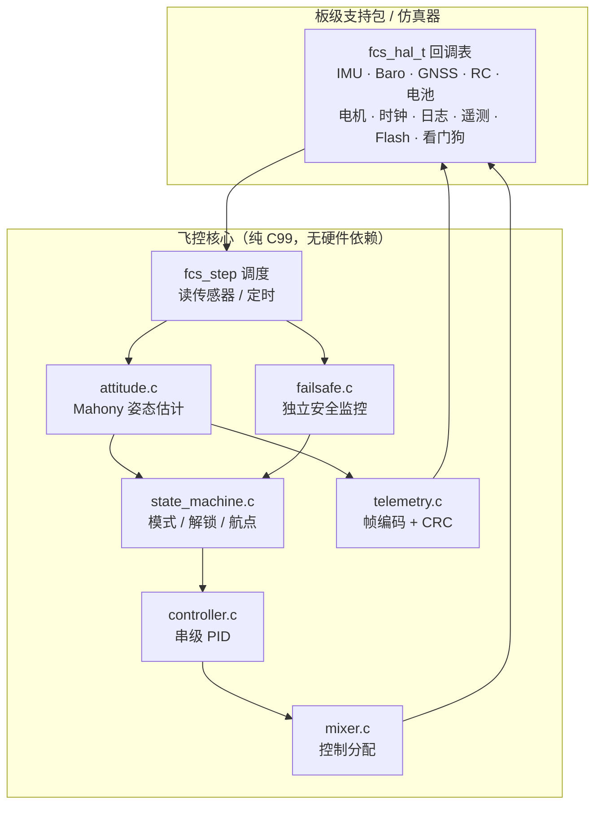

# UAV FCS Firmware · 无人机飞行控制系统固件

一个**可编译、可测试、可在 PC 上闭环飞行**的分层式四旋翼飞控固件（C99）。
核心代码不依赖任何操作系统、厂商 SDK 或动态内存，通过一层硬件抽象（HAL）同时运行在
STM32 类 MCU 与主机 SIL 仿真环境里。

> ⚠️ **安全声明**：本项目是工程参考 / 教学实现，未通过 DO-178C、ISO 26262 或任何适航认证，
> 也不包含完整 MAVLink、GPS/RTK 融合、冗余 IMU、ESC 校准等量产必需功能。
> **请勿未经充分验证直接安装到真实飞行器上。** 首次试车务必卸桨、限流供电。

---

## 特性一览

| 模块 | 实现 |
| --- | --- |
| 姿态估计 | Mahony 互补滤波（陀螺积分 + 加速度计重力校正 + 可选磁力计 + 陀螺零偏 PI 估计） |
| 控制律 | 位置 P+D → 期望加速度 → 倾角反解；角度 P → 角速率；角速率 PID（测量微分，无设定值冲击）→ 归一化力矩 |
| 高度 | 高度 P → 垂速指令 → 垂速 PI + 悬停油门前馈 |
| 控制分配 | X 型四旋翼 4×3 混控矩阵，姿态优先饱和策略（宁可牺牲总推力，也保姿态权限） |
| 模式 | `MANUAL` / `STABILIZE` / `ALT_HOLD` / `POS_HOLD` / `AUTO`（航点） |
| 状态机 | `DISARMED → ARMING → ARMED → LANDING → DISARMED`，含摇杆解锁、预解锁检查、自动降落 |
| 失效保护 | RC 丢失、电池欠压、姿态翻转、GNSS 丢失降级、IMU 连续故障、主循环卡死；kill 类故障**独立于控制器**直接断电 |
| 参数 | 单一结构体 + magic/version 校验 + 全字段范围钳制，可通过 HAL 持久化到 Flash/文件 |
| 遥测 | 自研 MAVLink 风格轻量帧（同步字 + 长度 + 序号 + 消息 ID + CRC16-CCITT），5 类消息 |
| 可测性 | 6 组单元测试 + 3 个闭环 SIL 场景，CI 中自动回归 |

---

## 快速开始

### 方式 A：CMake（Linux / macOS / MSVC）

```bash
cmake -S . -B build -DCMAKE_BUILD_TYPE=Release
cmake --build build -j
ctest --test-dir build --output-on-failure
```

### 方式 B：Make

```bash
make run          # 编译 + 单元测试 + 三个 SIL 场景
make test
make sil
```

### 方式 C：零依赖脚本（任意有 bash 的环境）

```bash
./scripts/build.sh all
```

脚本按 `$CC` → `cc` → `gcc` → `clang` → `zig cc` 的顺序自动找编译器；
若机器上没有 C 编译器，`pip install ziglang` 即可获得一个完整的 C 工具链。

### 手动飞一次仿真

```bash
./build/sil --scenario hover     --seconds 22 --out build/hover.csv
./build/sil --scenario waypoint  --seconds 55 --out build/waypoint.csv
./build/sil --scenario failsafe  --seconds 30 --out build/failsafe.csv
./build/sil --scenario hover --no-compass --verbose   # 无罗盘 / 打印日志
python tools/plot_telemetry.py build/waypoint.csv     # 画曲线（需 matplotlib）
```

`--out` 输出 CSV 遥测：时间、高度/设定值、位置/设定值、欧拉角、速度、四路电机、油门、解锁状态、模式、故障码。

---

## 实测结果（500 Hz 主循环，含传感器噪声与陀螺零偏）

| 场景 | 结果 | 关键指标 |
| --- | --- | --- |
| `hover` 定高悬停 22 s | **PASS** | 稳态高度误差 0.053 m，水平误差 0.223 m，最大倾角 1.24°，0 次失效保护 |
| `waypoint` 5 航点任务 55 s | **PASS** | 5/5 航点完成，最大倾角 20.9°，自动降落并上锁，落点误差约 2.2 m |
| `failsafe` 12 s 时断电+失控 30 s | **PASS** | 触发 2 次故障事件，进入 LANDING，最终 DISARMED、电机输出全 0 |
| 单元测试 | **6/6** | 数学/四元数、姿态收敛、控制律、混控、失效保护、顶层调度 |

CI（`.github/workflows/ci.yml`）会在每次 push 时重跑上述全部检查并上传飞行轨迹 CSV。

---

## 架构



一次 `fcs_step()` 的顺序是固定的：
**计时 → 采样 → 姿态估计 → 安全检查 → 状态机/设定值 → 控制 → 混控 → 电机输出 → 遥测 → 喂狗**。
`fcs_step()` 是确定性的、不阻塞、不分配内存，同一个 `fcs_t` 可以直接被 RTOS 任务或 1 kHz 定时器中断调用。

详见 [docs/ARCHITECTURE.md](docs/ARCHITECTURE.md)。

---

## 目录结构

```
include/fcs/          公共头文件（每个模块一个，含坐标系约定）
src/math/             向量 / 四元数 / 欧拉角 / 低通 / 斜坡限幅
src/estimation/       Mahony 姿态估计
src/control/          串级控制器 + X 四旋翼混控
src/core/             HAL 校验、参数、状态机、失效保护、遥测、顶层调度
platform/posix/       6-DOF 动力学 + 合成传感器 + SIL 主程序（仅主机）
platform/stm32/       STM32 HAL 模板与移植清单（仅参考，不参与主机编译）
tests/                6 组单元测试（自带极简断言框架）
tools/                轨迹绘图脚本
docs/                 架构、控制律推导、参数表、移植指南
```

---

## 控制律速览

```
水平位置误差 → a_des = Kp·(p_sp − p) − Kd·v                 [位置 P+D，限幅到 g·tan(max_tilt)]
a_des        → (roll_sp, pitch_sp) = tilt_from_accel(a_des, yaw)   [推力矢量小角度反解]
角度误差     → rate_sp = Kp_att · wrap_pi(angle_sp − angle)  [外环 P，限幅]
角速率误差   → torque  = Kp·e + Ki·∫e − Kd·d(rate)/dt      [内环 PID，微分作用于测量]
高度误差     → vz_sp → thrust = hover + Kp·(vz_sp − vz) + Ki·∫
(thrust, torque) → 4 路电机 = thrust + ½·M₄ₓ₃·torque       [混控 + 姿态优先饱和]
```

完整推导（含 NED 坐标系下的符号约定、为什么"正 pitch 向南加速"、饱和策略的证明）
见 [docs/CONTROL_LAW.md](docs/CONTROL_LAW.md)。

---

## 安全设计要点

- **双重电机互锁**：只有 `ARMED` / `LANDING` 才允许混控输出；`fcs_step()` 在调用
  `motor_write()` 之前再做一次独立清零，控制器就算写错也不会转桨。
- **解锁互锁**：油门最低 + 偏航右满舵持续 1 s + 预解锁检查（姿态水平 < 8.6°、电池、
  IMU 有效、油门低）→ `ARMING`（200 ms ESC 就绪）→ `ARMED`。
- **故障分级**：姿态翻转 / IMU 故障 / 主循环卡死 → 立即断电；
  RC 丢失 / 电池欠压 → 自动降落；GNSS 丢失 → 降级到 `ALT_HOLD` 并锁定，直到收到新的有效 GNSS 帧。
- **AUTO 模式的 RC 丢失**：任务执行中不因失联而坠落，继续航点飞行（与 PX4/ArduPilot 一致）。
- **航向辅助默认关闭**：GNSS 航向角（course）在侧滑/制动时并不等于机头朝向，弱增益反馈会与
  位置环构成正反馈。代码保留 `-DFCS_COURSE_AIDING=1`，仅建议双天线 GNSS 使用。
- **参数防呆**：Flash 里读出的每个字段都会被钳制到合法范围，避免一次位翻转把增益变成 999。

---

## 遥测协议

```
0xFE | LEN | SEQ | MSG_ID | PAYLOAD[LEN] | CRC16_LO | CRC16_HI
       CRC 覆盖 LEN..PAYLOAD，多项式 0x1021，初值 0xFFFF
```

| MSG_ID | 名称 | 载荷 |
| --- | --- | --- |
| 1 | HEARTBEAT | uptime_ms, arm, mode, fault, loop_us |
| 2 | ATTITUDE | roll/pitch/yaw + p/q/r（6 × float32 LE） |
| 3 | POSITION | pos_ned + vel_ned + alt（7 × float32 LE） |
| 4 | ACTUATORS | 4 路电机 + 总油门 |
| 5 | STATUS | 64 字节文本 |

这是 MAVLink **风格**的自定义帧，不是完整 MAVLink。替换成真正的 MAVLink 只需改写
`src/core/telemetry.c`，其余模块零改动（见架构文档）。

---

## 移植到 STM32

见 [docs/PORTING.md](docs/PORTING.md) 与
[platform/stm32/hal_stm32_template.c](platform/stm32/hal_stm32_template.c)：
实现 11 个 HAL 回调、把 `fcs_step()` 挂到 1 kHz 定时器、按优先级配置中断即可。
`fcs_core` 静态库不引用任何 `main()`、stdio 或 POSIX 符号。

---

## 后续可做的方向

- [ ] 替换成 EKF / ESKF（多 IMU 冗余、GNSS 紧耦合）
- [ ] 真正的 MAVLink 2 + 参数协议 / 任务协议
- [ ] 黑匣子日志（Flash 环形缓冲）+ 频域调参工具
- [ ] 固定翼 / 六旋翼混控矩阵与动力分配
- [ ] 硬件在环（HIL）、故障注入测试覆盖
- [ ] 符合 MISRA C:2012 的静态检查与 MC/DC 覆盖率

---

## 许可

MIT，见 [LICENSE](LICENSE)。
